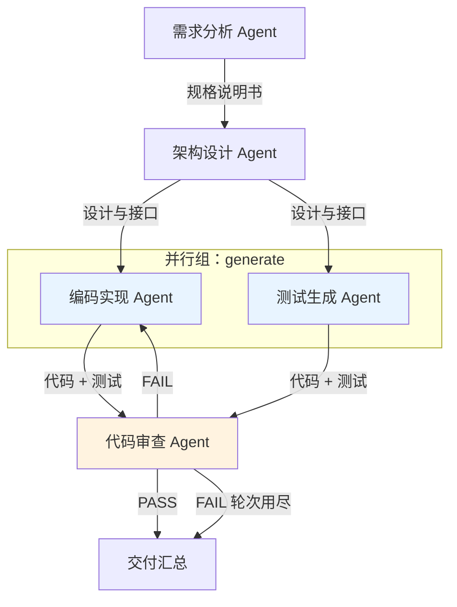

# Design.md —— 多 Agent 协作 Workflow 技术设计说明

> Homework 2 · Simple Workflow MVP · Mini SE 流程（需求 → 设计 → 代码）

---

## 1. 项目目标与范围

构建一个可运行的多 Agent 协作 Workflow：把一句自然语言需求，经需求分析、架构设计、编码、
测试生成、代码审查五个 Agent 接力，最终产出可运行的 Python 工程，并在审查不通过时**自动返工**。

设计目标按优先级排列：

1. **端到端跑通**：一条命令从需求到可运行代码，中间无人工干预；
2. **Agent 协作可观察**：Agent 之间的每一次交接都有显式消息、有落盘、可回放；
3. **流程可改**：新增 Agent 或调整走向，只改声明不改引擎；
4. **可恢复**：中途失败或中断，能从断点续跑，不重复烧 token。

范围约束：作业级别，命令行运行，不引入 LangChain / AutoGen 等框架；
代码透明、可讲解，仅依赖标准库（`requests` 可选）。

---

## 2. 总体架构（分层）

```
┌──────────────────────────────────────────────────────────────────┐
│ 交互层  run.py                                                    │
│  · 终端引导（选模式 / 录 Key）· 参数解析 · 结果汇总 · --resume      │
└───────────────────────────┬──────────────────────────────────────┘
                            │ Engine.execute(requirement)
┌───────────────────────────▼──────────────────────────────────────┐
│ 编排层  pipeline.py（Engine）                                      │
│  · 按图调度：串行 / 并行 / 条件分支 / 返工循环 / 断点恢复             │
│  · 节点生命周期：取输入 → 调 Agent → 落盘 → 发消息 → 更新状态         │
└──────┬─────────────────┬──────────────────┬──────────────────────┘
       │ 读流程定义        │ 写消息            │ 读写状态
┌──────▼──────┐  ┌───────▼────────┐  ┌──────▼─────────┐
│workflow.py  │  │ message.py     │  │ state.py       │
│节点+边+条件  │  │ MessageBus     │  │ WorkflowState  │
│声明式流程图  │  │ messages.jsonl │  │ state.json     │
└──────┬──────┘  └────────────────┘  └────────────────┘
       │ NodeSpec.agent
┌──────▼───────────────────────────────────────────────────────────┐
│ Agent 层  agents.py + prompts.py                                  │
│  RequirementAgent · DesignAgent · CodeAgent · TestAgent ·         │
│  ReviewAgent                                                      │
└──────┬───────────────────────────────────────────────────────────┘
       │ chat(messages)
┌──────▼───────────────┐   ┌────────────────────────────────────────┐
│ 模型层  llm.py        │   │ 工具层  tools.py / hooks.py             │
│  DeepSeek 客户端      │   │  · 静态检查（ast.parse）                │
│  requests / urllib    │   │  · 文件清单覆盖率核对                    │
│  重试 · 落盘审计       │   │  · 代码上下文拼装（预算截断）             │
└──────────────────────┘   └────────────────────────────────────────┘
```

**分层职责**：交互层只管人机对话；编排层只管"下一步做什么"；Agent 层只管"给定输入产出文本"；
模型层与工具层提供能力。任何一层都可单独替换。

---

## 3. Workflow 图

### 3.1 流程图



文本版（`python run.py --show-graph` 输出，无需渲染器）：

```
[requirement]        需求分析 Agent
    --规格说明书-->  design
[design]             架构设计 Agent
    --设计与接口-->  group:generate
[code] (并行组)       编码实现 Agent
    --代码 + 测试--> review
[test] (并行组)       测试生成 Agent
    --代码 + 测试--> review
[review]             代码审查 Agent
    --PASS-->              finalize
    --FAIL(轮次用尽)-->    finalize
    --FAIL-->              code    ← 返工循环
[finalize]           交付汇总
```

### 3.2 流程图里的四类控制结构

| 控制结构 | 在图中体现 | 实现位置 |
| --- | --- | --- |
| 顺序 | `requirement → design → code` | 无条件边 |
| 并行 | `code` 与 `test` 同属 `generate` 组 | `NodeSpec.group` + 线程池 |
| 条件分支 | `review` 的三条出边按顺序匹配 `when` | `Edge.when` |
| 循环 | `review --FAIL--> code`（`rerun=True`） | 回边 + 下游失效 + 轮次上限 |

### 3.3 声明式定义

流程写在 `workflow.py` 里，引擎不出现任何节点名：

```python
nodes = {
    "code": NodeSpec(name="code", agent="code",
                     inputs=("requirement_doc", "design_doc"),
                     output_key="code_files", group="generate",
                     prepare=hooks.prepare_code),
    "review": NodeSpec(name="review", agent="review",
                       inputs=("requirement_doc", "design_doc"),
                       output_path="04_review_r{round}.md",
                       prepare=hooks.prepare_review),
}

edges = {
    "review": [
        Edge(dst="finalize", when=review_passed,     label="PASS"),
        Edge(dst="finalize", when=review_exhausted,  label="FAIL(轮次用尽)"),
        Edge(dst="code",     when=review_retryable,  label="FAIL", rerun=True),
    ],
}
```

引擎只做三件事：`resolve(目标)` 展开节点、`validate()` 静态校验、按边顺序取第一个条件成立的边。

---

## 4. Agent 间通信：MessageBus

### 4.1 为什么不用函数直接传参

顺序流程用返回值传参当然更简单，但会带来三个问题：

1. 下游拿不到"上游为什么这么写"，只有最终文本，无法追溯；
2. 新增一个消费者（比如审查 Agent 要看设计）就得改所有中间节点签名；
3. 返工循环需要把审查意见回传给编码 Agent，直线传参表达不了"反向"通信。

因此本项目里 **Agent 不直接调用彼此**，所有交互都经过 `MessageBus`。

### 4.2 消息模型

```python
@dataclass
class Message:
    sender: str      # 谁发的，如 "review"
    receiver: str    # 发给谁，如 "code"；"*" 表示广播
    kind: str        # artifact / feedback / status / control / error
    summary: str     # 一句话摘要（终端与时间线展示用）
    payload: dict    # 结构化负载：产物路径、字符数、token 用量
    content: str     # 正文，落盘时截断到 4000 字符（全文在产物文件里）
    id / ts          # 消息 ID 与时间戳
```

五类消息各自的用途：

| kind | 生产者 → 消费者 | 语义 |
| --- | --- | --- |
| `artifact` | 任一 Agent → `*` | 我产出了某个文件，路径与规模在此 |
| `feedback` | `review` → `code` | 审查未通过，附问题清单，驱动返工 |
| `control` | `engine` → 返工目标 | 流程控制：重置节点、重新执行 |
| `status` | `engine` → `*` | 流程启动、节点状态变更 |
| `error` | 失败节点 → `engine` | 异常上报，附错误摘要 |

### 4.3 一次真实运行的通信序列

取自 `runs/<id>/messages.jsonl`（审查驳回一轮后通过）：

```
engine      -> *     [status  ] workflow mini-se started
requirement -> *     [artifact] 需求分析 Agent 完成 -> 01_requirement.md（1467 字符）
design      -> *     [artifact] 架构设计 Agent 完成 -> 02_design.md（2616 字符）
test        -> *     [artifact] 测试生成 Agent 完成 -> 03_code/（1 个文件）
code        -> *     [artifact] 编码实现 Agent 完成 -> 03_code/（4 个文件）
review      -> code  [feedback] 审查未通过，回传 2 条问题
review      -> *     [artifact] 代码审查 Agent 完成 -> 04_review_r1.md
engine      -> code  [control ] 返工重置 code, finalize, review（第 1 轮审查未通过）
code        -> *     [artifact] 编码实现 Agent 完成 -> 03_code/（4 个文件）
review      -> *     [artifact] 代码审查 Agent 完成 -> 04_review_r2.md
finalize    -> *     [artifact] 交付说明 -> 05_delivery.md
```

注意第 6 行：**反馈消息的方向是反的**（review → code），这是直线传参做不到的。
第 7 行：控制消息记录了失效范围，解释了为什么 review 会重跑。

### 4.4 线程安全

并行组内两个 Agent 会并发 `publish`，因此总线的写入与索引都加锁；
`content` 落盘截断到 4000 字符，避免 jsonl 被超长正文撑爆。

---

## 5. 共享状态：WorkflowState

消息是**事件**（发生了什么），状态是**快照**（现在是什么情况）。两者缺一不可。

### 5.1 结构

```json
{
  "run_id": "20261024-005048-133a",
  "workflow": "mini-se",
  "status": "completed",
  "requirement": "做一个命令行待办清单工具……",
  "nodes": {
    "code":   {"status": "done", "elapsed_sec": 2.0, "output": "03_code/（4 个文件）", "round": null},
    "review": {"status": "done", "elapsed_sec": 0.0, "output": "04_review_r2.md", "round": 2}
  },
  "artifacts": {
    "design_doc": {"type": "text",  "path": "02_design.md", "chars": 2616, "sha256": "…"},
    "code_files": {"type": "files", "paths": ["todo.py", "storage.py", "…"], "count": 4}
  },
  "review": {"passed": true, "p0": 0, "p1": 0, "p2": 1, "issues": ["…"], "rounds": 2},
  "pending_feedback": "",
  "usage": {"prompt_tokens": 8100, "completion_tokens": 10000, "total_tokens": 18143},
  "next_node": "finalize"
}
```

### 5.2 节点状态机

```
pending ──mark(RUNNING)──► running ──成功──► done
   ▲                          │
   │                          └──失败──► failed
   │                                       
   └──── 回边失效（重置下游）──────────────┘
```

### 5.3 三个关键字段

- `artifacts`：产物索引。Agent 不传内容，只传 key，引擎按 key 从磁盘取——
  避免把大段文本塞进内存和消息；
- `review`：审查结论。条件边的 `when` 函数直接读它，**流程走向由数据决定，不由代码决定**；
- `next_node`：下一步。`--resume` 就是从这里接着走。

### 5.4 持久化

每次 `mark_node` / `put_text` / `put_files` 都会触发一次原子写
（临时文件 + `os.replace`），整段写入持锁。因此进程被 kill 后 `state.json` 仍是可解析的。

---

## 6. 执行引擎

### 6.1 调度主循环

```python
def _loop(self):
    next_batch = [self.state.get("next_node") or self.spec.start]
    steps = 0
    while next_batch:
        steps += 1
        if steps > self.spec.max_steps:          # 防不收敛
            raise EngineError("超过最大步数")
        nodes = self.spec.resolve(next_batch[0])  # "group:generate" -> ["code","test"]
        self._run_batch(nodes)
        next_batch = self._route(nodes)
```

### 6.2 批次执行

```python
def _run_batch(self, names):
    targets = [n for n in names if not self.state.is_done(n)]   # 断点续跑：跳过已完成
    if not targets:
        return
    if len(targets) > 1 and self.cfg.parallel:
        with ThreadPoolExecutor(max_workers=len(targets)) as pool:
            futures = {pool.submit(self._run_node, self.spec.node(n)): n for n in targets}
            for f in as_completed(futures):
                f.result()          # 任一分支失败即中断，不留半成品
    else:
        for name in targets:
            self._run_node(self.spec.node(name))
```

### 6.3 单节点生命周期

```python
def _run_node(self, spec):
    round_no = 递增审查轮次(spec)                      # 仅 review 节点
    state.mark_node(spec.name, RUNNING, round=round_no)

    for attempt in (1, 2):                             # 语法自检最多补救一次
        args   = 从 state 读 inputs + spec.prepare(state, run)   # 钩子补上下文
        args   = 按 build_messages 签名过滤                        # 多余参数自动丢弃
        result = agents[spec.agent].run(**args)

        落盘 (文本 → put_text / 文件集 → put_files)
        errors = ast 语法检查(刚写盘的文件)              # 代码类节点才做

        if not errors:
            break
        if attempt == 2:
            记 warning 交由审查环节判定
            break
        重试一次，并把错误行号作为 feedback 注入下一轮 Prompt

    bus.publish(artifact 消息)
    state.mark_node(spec.name, DONE, elapsed, output, round, self_retried)
    state.add_usage(result.usage)
```

「按签名过滤参数」这一行让 `NodeSpec.inputs` 可以多写：
审查节点把 `code_files` 也列进 inputs，但 `ReviewAgent.build_messages` 不接收它，
过滤后自然丢弃，不会报 `TypeError`。

**为什么落盘就自检**：真实运行中出现过测试文件字符串未闭合、导致整个测试套件
无法收集的情况。这类错误 `ast` 一秒就能发现，没必要花一整轮审查（十几秒 + 上万 token）
去让 LLM 指出来。自检失败会带着错误行号重试，重试次数记在 `self_retried`。

### 6.4 条件路由与返工失效

```python
def _route(self, executed):
    edges = [第一个条件成立的出边 for each node in executed]
    if not edges: return []                      # 到达终止节点
    校验并行分支出口一致
    if chosen.rerun:                             # 回边
        targets = resolve(chosen.dst)            # ["code"]
        self._invalidate_from(targets)           # code + 其全部下游 -> pending
    state.set("next_node", chosen.dst)
    return [chosen.dst]
```

`_invalidate_from` 做 BFS：从 `code` 出发沿边可达的节点是 `code → review → finalize`，
全部打回 pending，于是 review 会重新审查新一轮代码。

**为什么不连带重置 `test`**：`test` 不在 `code` 的下游（两者是兄弟），
测试锚定的是设计而非实现，实现返工不需要重写测试。

**例外**：如果审查问题清单里出现 `tests/` 开头的文件，说明测试代码本身有缺陷，
只重跑实现是修不好的（真实运行中发生过：测试文件语法错误连报两轮）。
此时会把整个并行组一起重置：

```python
node = spec.node("code")
if node.group and any("tests/" in item for item in review_issues):
    targets = spec.group_members(node.group)      # ["code", "test"]
```

### 6.5 收敛保证

| 保护 | 值 | 触发后的行为 |
| --- | --- | --- |
| 返工轮次上限 | 2 | 第三次仍 FAIL 则走 `FAIL(轮次用尽)` 边直接交付，遗留问题写进交付说明，退出码 3 |
| 语法自检重试 | 1 | 落盘后 `ast` 校验失败，带错误行号重试该节点一次 |
| 最大步数 | 32 | 抛 `EngineError`，判定为流程配置错误 |
| 单次调用重试 | 3 | 仅对网络 / 429 / 5xx，指数退避 |
| 输出截断检测 | `finish_reason == "length"` | 记 warning；代码节点另有分批机制从根源避免 |

### 6.6 长输出治理：代码分批生成

单次调用输出上限 8K token。真实运行中，需求最终要求 11 个文件（约 34K 字符），
一次性生成必然在尾部截断：`setup.cfg`、`README.md` 直接消失，
最后一个文件内容停在半个语句上，随后审查连报两轮同一个语法错误。

治理放在 Agent 内部，对引擎透明：

```python
def run(self, requirement, requirement_doc, design_doc, feedback=""):
    files = extract_expected_files(design_doc)     # 解析第 11 节表格
    batches = self.plan_batches(files)             # 每批 <= 4 个文件
    if len(batches) <= 1:
        return super().run(...)                    # 小工程不分批
    for i, batch in enumerate(batches, 1):
        messages = build_code_messages(..., batch=batch, batch_index=i, batch_total=len(batches))
        parts.append(client.chat(messages, tag=f"code_b{i}").text)
    return AgentResult(output="\n\n".join(parts), ...)   # 合并成一个输出
```

每批的 Prompt 都声明"你只负责这几个文件，不要重复输出别人的"，并附完整设计文档，
保证跨文件的接口签名一致。合并后的文本走同一套 `parse_code_files` 解析，
对下游与状态层完全透明。

---

## 7. 质量门禁：审查 Agent 的双重依据

审查不只看模型脸色，先跑确定性的本地检查：

```python
static = static_check(base_dir, files, expected)   # ast.parse + 清单覆盖率
context, truncated = build_code_context(...)       # 拼代码，超预算截断
```

`static_report` 与代码一起进 Prompt，审查报告里的事实（"缺少 xxx.py"、"第 42 行语法错误"）
来自工具而非模型臆测。这解决了纯粹 LLM 审查的两个通病：漏检语法错误、编造不存在的问题。

报告格式固定，解析器据此判定：

```
## 审查结论
PASS / FAIL

## 问题清单
| 编号 | 级别 | 文件 | 问题 | 修改建议 |
| 1 | P0 | todo.py | …… | …… |
```

解析规则（`parse_review`）：

1. 优先取「审查结论」段后的 PASS/FAIL；
2. 兜底取全文首个独立 PASS/FAIL；
3. **出现 P0 却写 PASS 视为自相矛盾，强制改判 FAIL**；
4. 无结论默认 FAIL（宁可严格）。

---

## 8. 模块详细设计

| 文件 | 核心对象 | 职责 |
| --- | --- | --- |
| `run.py` | `main()` / `Engine` 调用 | 参数解析、终端引导、`--resume`、结果汇总 |
| `workflow.py` | `NodeSpec` `Edge` `WorkflowSpec` | 声明流程；`validate()` 静态校验；`ascii_diagram()` / `mermaid()` 出图 |
| `pipeline.py` | `Engine` `PipelineResult` | 批次调度、并行执行、条件路由、循环失效、meta/summary 落盘 |
| `message.py` | `Message` `MessageBus` | 消息投递、按收件人检索、jsonl 持久化与回放 |
| `state.py` | `WorkflowState` | 共享状态、节点状态机、产物索引、原子持久化 |
| `agents.py` | `BaseAgent` + 5 个子类 `ReviewVerdict` | 各 Agent 的 Prompt 组装；审查结论解析 |
| `prompts.py` | 5 组 system/user 提示词 | 角色约束与输出格式契约 |
| `hooks.py` | `prepare_*` / `finalize_delivery` | 节点专属上下文准备、交付清单生成 |
| `tools.py` | `static_check` `build_code_context` | 不花 token 的确定性检查与上下文拼装 |
| `llm.py` | `DeepSeekClient` | 对话补全、双 HTTP 后端、重试、请求响应落盘 |
| `artifacts.py` | `RunContext` `RunLogger` `parse_code_files` | 运行目录隔离、路径安全、代码块解析 |
| `config.py` | `Config` | 配置优先级：CLI > 环境变量 > `.env` > 默认 |
| `mock.py` | `MockClient` | 离线演示数据（含一次模拟 FAIL 以展示返工） |

---

## 9. 运行目录与产物

```
runs/<run_id>/
├── SUMMARY.md           一页纸摘要（节点表 + 消息时间线）
├── state.json           共享状态快照（断点续跑的依据）
├── messages.jsonl       全部 Agent 消息，可回放
├── meta.json            机器可读的运行元数据
├── requirement_input.txt
├── 01_requirement.md    需求规格说明书
├── 02_design.md         技术设计说明书
├── 03_code/             代码 + tests/
├── code_raw.txt         编码 Agent 原始输出（含文件分隔标记，排查解析用）
├── test_raw.txt         测试 Agent 原始输出
├── 04_review_r1.md      第 1 轮审查（FAIL）
├── 04_review_r2.md      第 2 轮审查（PASS）
├── 05_delivery.md       交付说明（含遗留问题）
├── llm/                 每次调用的请求与响应原文
└── run.log              完整日志
```

`run_id = YYYYMMDD-HHMMSS-<4位随机>`，用 `os.makedirs(exist_ok=False)` 创建，
**多次运行完全隔离，互不覆盖**；`--run-id` 指定的目录若已存在则直接拒绝。

---

## 10. 错误处理与恢复

| 场景 | 策略 |
| --- | --- |
| API 401 / 402 / 400 | 不重试，立即失败，给出针对性提示 |
| 网络异常 / 5xx / 429 | 指数退避重试（1.6^n 秒，最多 3 次） |
| 响应非法 JSON / 空内容 | 视为可重试错误 |
| Agent 输出解析不出文件块 | 该节点失败，原文存 `{node}_raw.txt`，指向解析协查 |
| 并行分支之一失败 | 立即向上抛，已完成的兄弟节点产物保留 |
| 用户 Ctrl+C | state 标记 `interrupted`，打印续跑命令，退出码 130 |
| 进程被 kill | `state.json` 已落盘，`--resume` 从 `next_node` 继续 |

`--resume` 的行为：

1. 读 `state.json`，恢复模式（live/mock）与全部产物索引；
2. 从 `next_node` 开始，`is_done` 的节点自动跳过；
3. 重放 `messages.jsonl`，消息上下文接续而非重来。

---

## 11. 可扩展性

### 11.1 新增一个 Agent（三步，不改引擎）

以加一个「文档生成 Agent」为例：

```python
# ① prompts.py 加 system/user 提示词
# ② agents.py
class DocAgent(BaseAgent):
    stage, title, output_name = "doc", "文档生成 Agent", "06_doc.md"
    def build_messages(self, design_doc, code_files):
        return prompts.build_doc_messages(design_doc, code_files)

# ③ workflow.py 注册节点与边
nodes["doc"] = NodeSpec(name="doc", agent="doc",
                        inputs=("design_doc", "code_files"),
                        output_key="doc", output_path="06_doc.md")
edges["review"] = [Edge(dst="doc", when=review_passed), ...]
edges["doc"] = [Edge(dst="finalize")]
```

再在 `pipeline.py` 的 `self.agents` 注册表加一行即可。
消息、状态、日志、token 统计、目录隔离全部自动继承。

### 11.2 修改流程走向

- 去掉返工循环：删掉 `review` 的第三条边；
- 调整返工次数：改 `MAX_REVIEW_ROUNDS`；
- 把并行改串行：去掉 `group` 字段，或在命令上加 `--no-parallel`；
- 换一套完全不同的流程（如"编码 → 审查 → 修复"）：新写一个 `WorkflowSpec`，
  `Engine(cfg, run, spec=other_spec)` 即可，不需要动引擎。

### 11.3 校验机制

`WorkflowSpec.validate()` 在启动前检查：起点存在、边指向存在、无条件边必须在最后、
并行组内各节点出口一致。有问题直接报错，不会跑到一半才发现图是错的。

---

## 12. 关键设计决策

1. **声明式图 + 通用引擎，而非硬编码流水线**
   换来的是可扩展性：加节点改声明，不动调度。代价是引擎里多了一层 `resolve` / `route` 抽象。

2. **消息与状态分离**
   只做消息，无法回答"现在进展到哪"；只做状态，无法还原"谁告诉了谁什么"。
   两者并存，前者供追溯，后者供决策与恢复。

3. **产物用 key 索引，不塞进消息**
   代码和文档动辄数千字符，全部塞进消息会让 jsonl 与内存都失控。
   消息只记路径与规模，内容留在磁盘。

4. **返工失效只向下游传播**
   从回边目标做 BFS，兄弟节点不受影响。既保证正确（review 必须重跑），又避免浪费（test 不用重跑）。

5. **审查结论用固定格式 + 严格解析**
   LLM 输出不可控，用「结论段 + 表格」把关键信息钉死；
   再加"有 P0 却判 PASS 则强制 FAIL"的兜底，避免模型和稀泥。

6. **确定性检查放在 LLM 之前**
   语法错误、文件缺失这类事实用 `ast` 判断，比问模型又快又准，也让审查报告有据可依。

7. **离线 Mock 覆盖全部控制流**
   Mock 第一轮故意 FAIL、第二轮 PASS，因此不联网也能演示并行、分支、循环三件事，
   评审时不必依赖 API Key。

8. **长输出用分批解决，而不是调大上限**
   8K 是模型硬上限，调参解决不了。把"一次生成整个工程"拆成"每批 4 个文件"，
   是在能力边界内的正确做法；代价是跨文件一致性要靠完整设计文档来锚定。

---

## 13. 与评审标准的对应

| 维度 | 权重 | 本项目对应实现 |
| --- | --- | --- |
| 流程完整性 | 40% | 5 Agent + 6 节点端到端跑通；产物可直接运行；Mock 也能完整演示 |
| Agent 协作 | 30% | MessageBus 五类消息 + jsonl 可回放；WorkflowState 共享状态 + 状态机 |
| 可扩展性 | 20% | 声明式 NodeSpec/Edge；`validate()` 静态校验；新增 Agent 三步接入 |
| 文档 | 10% | 本文件 + README（架构图、时序、流程图、使用说明） |

---

## 14. 后续可做

- 可视化编排：把 `WorkflowSpec` 渲染成可拖拽画布；
- 更多工具节点：跑测试（`unittest` 执行结果回灌审查）、跑 lint；
- 多模型异构：设计与编码用不同模型，比较产出质量；
- 成本控制：按节点设置 `max_tokens` 预算，超预算降级模型。
